<a href="#about-this-title"></a>

  
  
  

### Trending Now

  
  <a href="https://github.com/KumarAyushh/CodeSense">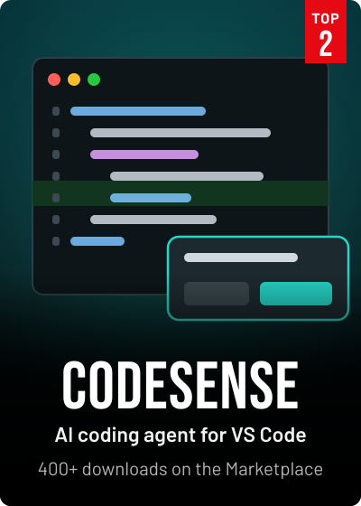</a>
  <a href="https://github.com/KumarAyushh/RAG-Based-PDF-QA">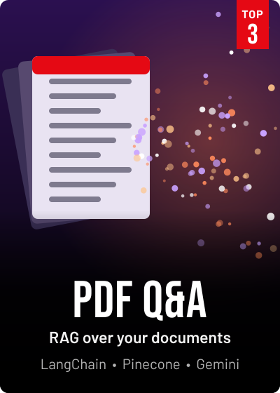</a>

### Coming Soon

  <a href="https://github.com/KumarAyushh/MeetMind">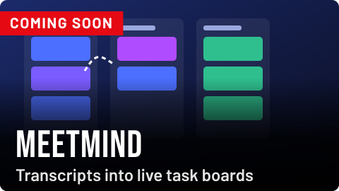</a>
  <a href="https://github.com/KumarAyushh/NovaCEX">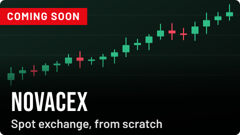</a>
  <a href="https://github.com/KumarAyushh/secondbrain">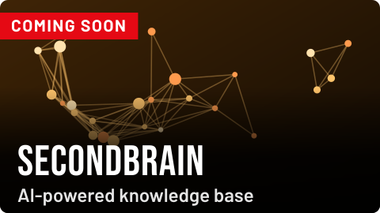</a>

### Continue Watching

  <a href="https://github.com/KumarAyushh/LLD">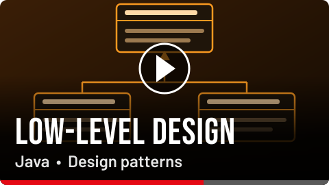</a>
  
  <a href="https://github.com/KumarAyushh/python-for-ai">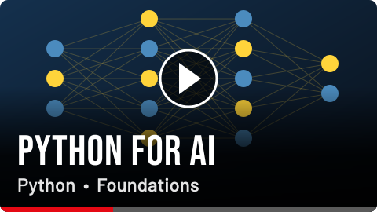</a>

### Starring

  
  
  
  
  
  
  
  
   
  
  <a href="https://fastapi.tiangolo.com/">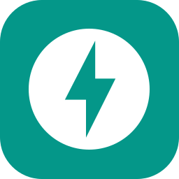</a>
  
  
  <a href="https://kafka.apache.org/documentation/">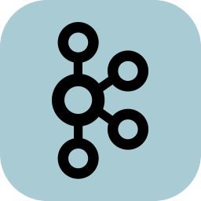</a>
  
  <a href="https://www.prisma.io/docs">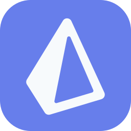</a>
  

### Viewing Activity

  

### About This Title

I'm Kumar Ayush, a software engineer with a B.Tech in Computer Science and Engineering. I build backend systems, AI agents and developer tools end to end, and I enjoy collaborating on projects.

- **Now filming:** [MeetMind](https://github.com/KumarAyushh/MeetMind) and [NovaCEX](https://github.com/KumarAyushh/NovaCEX)
- **In training:** Go, low-level design and Python for AI
- **Off screen:** Playing chess

### Who's Watching?

Pick a profile to get in touch.

  
  
  <a href="https://leetcode.com/ayushcodes23">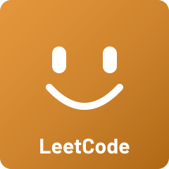</a>
  
  

